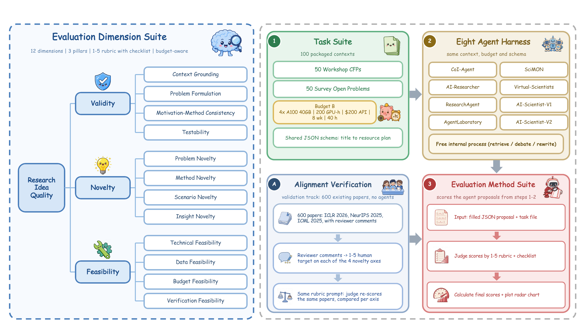

# AlphaIdeaBench

LLM-as-judge code for scoring research ideas on **twelve dimensions**. The human check in the paper is only on the **four novelty axes**: reviewer comments are turned into 1-5 targets, then compared with a blinded judge.

This repository is judge-only. It does not generate ideas.

<p align="center">
  
</p>
<p align="center">
  <em>Overview of AlphaIdeaBench. This repo releases the 12-dimension judge (left and step 3), the 100-task suite (step 1), and the novelty alignment track (A). The eight harnesses in step 2 are external systems.</em>
</p>

## Twelve dimensions

| Group | Dimensions |
| --- | --- |
| Validity | Context grounding, Problem formulation, Motivation and method consistency, Testability |
| Novelty | Problem novelty, Method novelty, Scenario novelty, Insight novelty |
| Feasibility | Technical feasibility, Data feasibility, Budget feasibility, Verification feasibility |

Overall is the unweighted mean of these twelve scores. Each dimension is an independent judge call with its own rubric and checklist in `prompts/dimensions.yaml`.

Validity and feasibility have no human reference in the paper. They are scored against the written plan and the resource envelope. Only novelty is calibrated against peer review.

## Install

```bash
python -m venv .venv
source .venv/bin/activate
pip install -e ".[dev]"
cp .env.example .env
```

Set `OPENROUTER_API_KEY` in `.env`. The default chat model is in `configs/default.yaml`. Use `configs/gemini.yaml` for the native Gemini endpoint.

## 1. Score an idea (12 dimensions)

Dry run (no API):

```bash
alphaideabench list-dimensions
alphaideabench judge \
  --topic examples/topics/icbinb.md \
  --ideas examples/ideas/sample_idea.json \
  --repeats 1 --dry-run --skip-track2
```

Real judge:

```bash
alphaideabench judge \
  --topic examples/topics/icbinb.md \
  --ideas examples/ideas/sample_idea.json \
  --repeats 1 --skip-track2 --workers 12
```

`--ideas` can be one JSON file or a directory. The schema is documented below. Outputs go to `outputs/run_<timestamp>/`.

## 2. Align novelty with human review comments

The paper meta-evaluation maps reviewer text onto **problem, method, scenario, and insight novelty only**. Facets the reviews never mention are left missing. The judge is blinded to reviews and sees title and abstract only.

Two stages build the human-derived reference, then a third compares the judge:

```bash
# 1. extract novelty quotes from reviews, then score only from those quotes
python scripts/novelty_reference.py \
  --papers examples/reviews/sample_papers.json \
  --dry-run --out outputs/novelty_reference/sample

# 2. judge title+abstract only (reviews are never shown)
python scripts/judge_iclr_novelty.py \
  --papers examples/reviews/sample_papers.json \
  --reference outputs/novelty_reference/sample/papers.json \
  --topic examples/topics/icbinb.md \
  --dry-run --out outputs/judge_iclr_novelty/sample

# 3. DistAcc, MAD, within +/- 1, exact agreement, 3-class accuracy, Spearman
python scripts/align_judge_to_human.py \
  --judge examples/alignment/judge_scores.json \
  --human examples/alignment/human_scores.json

# optional: coverage of human quotes by judge reasoning (needs embeddings)
python scripts/compute_coverage_openai.py \
  --human outputs/novelty_reference/sample/records.jsonl \
  --judge outputs/judge_iclr_novelty/sample/records.jsonl
```

`scripts/map_reviews_to_dimensions.py` can project a review onto all twelve rows of the rubric. That is not the paper protocol: validity and feasibility were not human-aligned.

## Idea JSON

```json
{
  "idea_id": "my-topic-01",
  "title": "...",
  "research_question": "...",
  "problem": "...",
  "motivation": "...",
  "method": "...",
  "experiments": "...",
  "baselines": "...",
  "success_criteria": "...",
  "related_work": "...",
  "limitations": "...",
  "resource_plan": {"gpu": "1x RTX 4090 24GB", "estimated_gpu_hours": 30}
}
```

Only `title` is required. AI-Scientist-v2 ideation JSON (`Name` / `Title` / `Short Hypothesis` / ...) is also accepted.

## Topic markdown

The topic file is the judge's factual boundary. Novelty is scored against the prior work written here, not against a live web search. The YAML frontmatter must include a `budget` block.

See `examples/topics/icbinb.md`.

## 100-task suite

The paper uses 50 workshop CFPs and 50 survey open problems, each with a shared academic-lab resource envelope in the YAML frontmatter.

```
tasks/workshops/     50 workshop CFP markdown files
tasks/surveys/       50 survey markdown files
tasks/index.json     id, title, field, and path for all 100
```

Score one idea against a released task:

```bash
alphaideabench judge \
  --topic tasks/workshops/ws_02_agentic_ai.md \
  --ideas examples/ideas/sample_idea.json \
  --repeats 1 --skip-track2
```

## Tests

```bash
pytest
```

## Layout

```
docs/                 paper figures used in this README
src/alphaideabench/   judge agent, 12-dimension rubric loader, Track 1/2
prompts/              judge and novelty-mapping prompts; dimensions.yaml
scripts/
  novelty_reference.py           extract review quotes, then score novelty
  judge_iclr_novelty.py          judge title+abstract; correlate vs reference
  align_judge_to_human.py        DistAcc / MAD / Spearman
  compute_coverage_openai.py     remark coverage via embeddings
  map_reviews_to_dimensions.py   optional 12-row projection; not used in the paper
tasks/                100 paper tasks: 50 workshops + 50 surveys
examples/             topic, idea, sample reviews, alignment fixtures
```
